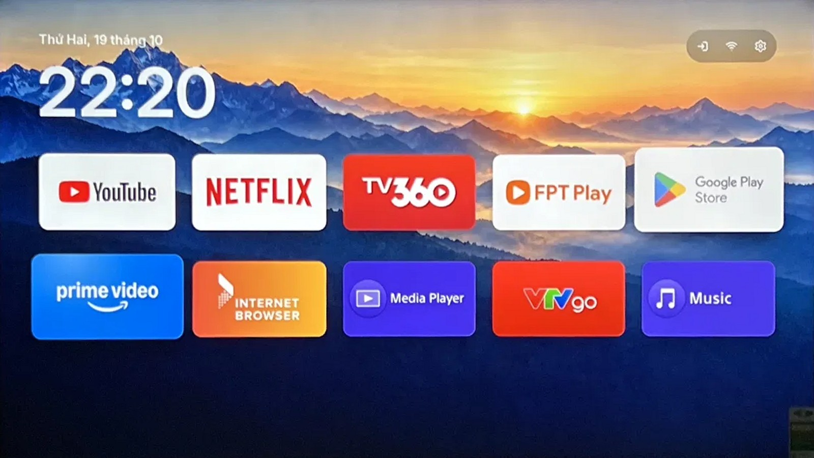
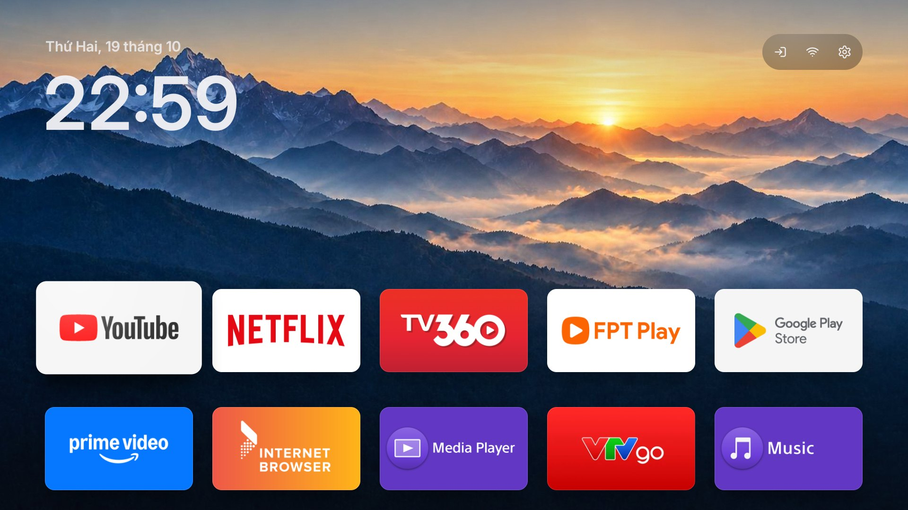
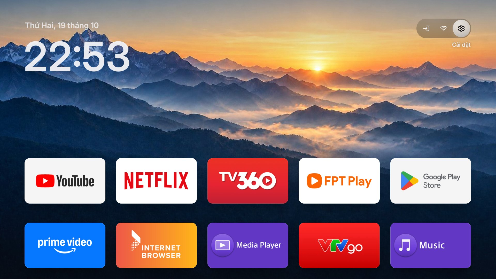
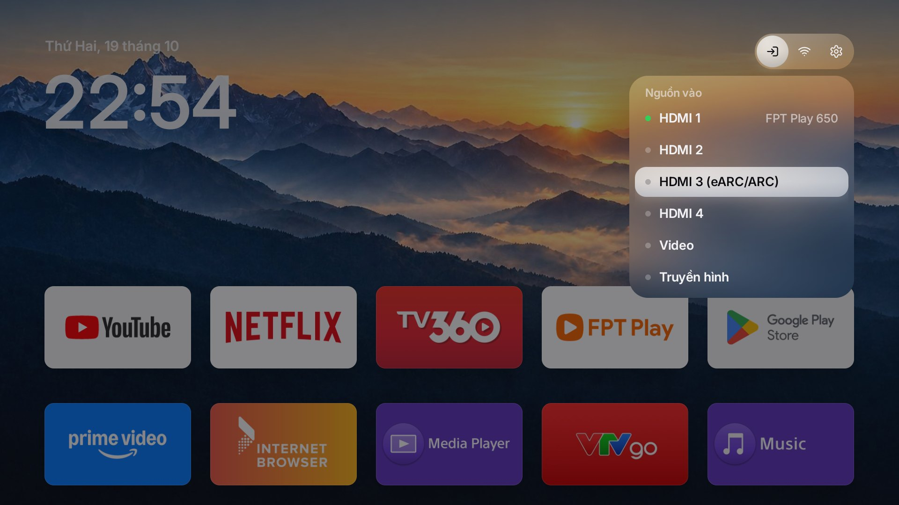
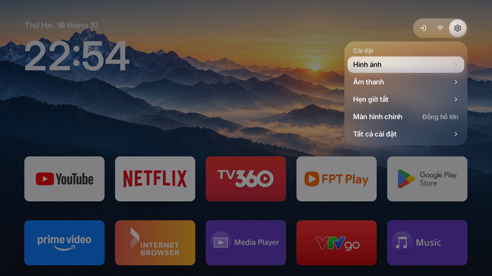
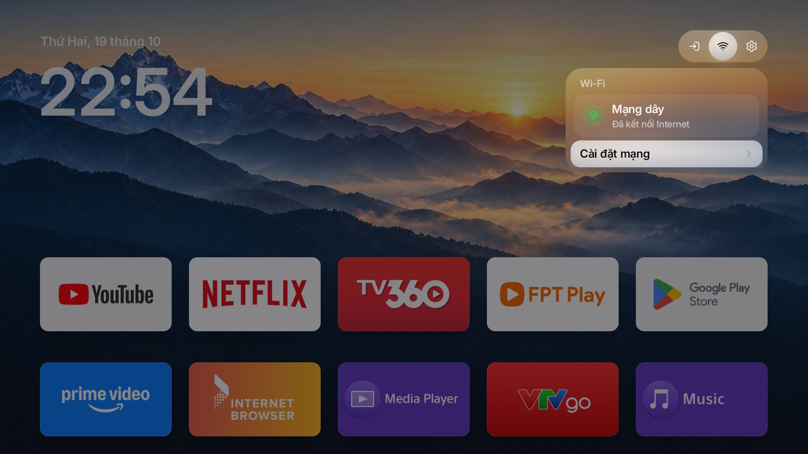
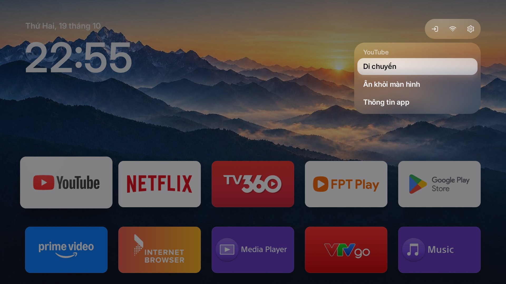

<div align="center">

# OwnTV

### Your TV. Your apps. Nothing else.

A fast, ad-free home screen for Android TV and Google TV, with the calm and polish of Apple TV.
No sponsored rows, no autoplay, nothing running in the background.

English · [Tiếng Việt](README.vi.md) · [简体中文](README.zh-CN.md)




<sub>Screenshot from a Sony BRAVIA XR-65X95J.</sub>

</div>

---

## Contents

- [Why](#why)
- [Features](#features)
- [Requirements](#requirements)
- [Install on Windows](#install-on-windows)
- [Install by hand (any OS)](#install-by-hand-any-os)
- [Using it](#using-it)
- [Switching off background apps](#switching-off-background-apps)
- [Customising](#customising)
- [Undo everything](#undo-everything)
- [Tested devices](#tested-devices)
- [Privacy](#privacy)
- [Contributing](#contributing)
- [Acknowledgements](#acknowledgements)
- [Licence](#licence)

## Why

The stock Google TV home screen is a shop window: sponsored rows, autoplaying trailers and a dozen
vendor services that start with the TV and never stop. OwnTV replaces it with a home screen that
does one thing well: get you to the app you want, quickly and quietly.

## Screenshots

<table>
<tr><td><br><sub>Large clock style</sub></td><td><br><sub>Top bar, Settings focused</sub></td></tr>
<tr><td><br><sub>Inputs, with HDMI-CEC device names</sub></td><td><br><sub>Settings</sub></td></tr>
<tr><td><br><sub>Wi-Fi status</sub></td><td><br><sub>Hold OK on an app</sub></td></tr>
</table>

## Features

**Design**
- Frosted-glass top bar with Inputs, Wi-Fi and Settings. A single droplet glides between the buttons
  on a light spring; the buttons never resize, so nothing jumps.
- Apps open with a zoom from their own tile and close back into it, drawn frame by frame with
  anti-aliased corners, so there is no white flash and no jagged scaling.
- The wallpaper drifts slightly with the focus for a sense of depth. A soft "tick" on every move and
  a gentle nudge at the edges, following the TV's system sound setting.
- Inter typeface throughout, chosen for its closeness to SF Pro and its full Vietnamese support.

**Everyday use**
- Inputs panel lists HDMI ports with the names of connected devices (via HDMI-CEC), plus Live TV.
- Wi-Fi panel shows what you are connected to and whether the internet is reachable.
- Settings panel with the items people actually use: Picture, Sound, Sleep timer, Home screen style,
  All settings. Anything your TV cannot open is left out automatically.
- Optional large date and clock on the left (Settings › Home screen).
- Hold OK on an app to move it, hide it or open its info. Left and right read the grid like a line of
  text; Right on the last app returns to the first.
- A clock screensaver that drifts slowly to protect the panel.
- Interface in English, Vietnamese and Simplified Chinese, picked from the TV's language.

**Performance**
- No live blur: the glass uses one tiny pre-blurred copy of the wallpaper.
- Tile shadows are baked once and reused; animations touch only transform and alpha.
- A built-in measurement (option 5) reports cold and warm start time, dropped frames and memory against targets.

## Requirements

- A TV or box running **Android TV or Google TV 8.0 or newer** (Sony, TCL, Xiaomi, Philips, Hisense,
  NVIDIA Shield, Chromecast with Google TV and others).
  Samsung (Tizen) and LG (webOS) TVs do not run Android and are not supported.
- **Developer options** with network debugging switched on (steps below). On Android 11 and newer, if your TV
  only offers *Wireless debugging*, option 1 walks you through pairing it with a code.
- A computer on the same network. The one-click scripts are for **Windows 10/11**; on macOS or Linux
  use the manual steps.

## Install on Windows

1. **Turn on developer options on the TV.** Settings › System › About › select *Build* seven times.
   Then Settings › System › Developer options › switch on *USB debugging* (and *Network debugging*
   if your TV lists it). Note the TV's IP address under Settings › Network.
2. **Download this repository** (green *Code* button › *Download ZIP*) and unzip it.
3. **Open `OwnTV.cmd` and choose 1.** The first run downloads Java 17 and the Android build tools
   (about 600 MB, 10–20 minutes); later runs take seconds. When the TV asks *Allow USB debugging?*,
   tick *Always allow* and confirm. From then on, turning on the TV or pressing Home opens OwnTV.
   The script presses Home itself to check and puts everything back if Home does not land on OwnTV.

`OwnTV.cmd` is the only file you need to open; everything is in its menu:

| Option | What it does |
|---|---|
| 1 | Installs OwnTV and makes it the home screen |
| 2 | Brings back the original home screen |
| 3 | Switches off background, advertising and tracking apps (Sony list), group by group. Optional |
| 4 | Restores everything option 3 switched off |
| 5 | Measures start time, dropped frames and memory |

> The prompts are in Vietnamese, with English hints in the menu. Every option asks before changing
> anything, keeps a backup and can be undone. If you prefer English, the manual steps below do the same.

## Install by hand (any OS)

You need [ADB](https://developer.android.com/tools/releases/platform-tools) and JDK 17.

```sh
# build
cd launcher
./gradlew assembleDebug            # Windows: gradlew.bat assembleDebug

# install
adb connect <TV_IP>:5555
adb install -r app/build/outputs/apk/debug/app-debug.apk
```

Make it the home screen:

```sh
adb shell cmd package set-home-activity --user 0 io.github.ledat100398.tvhome/.MainActivity
```

On **Google TV** the stock launcher takes Home back, and when it is missing the setup wizard claims
Home to "repair" it. Remove both for the current user only (nothing is deleted from the TV):

```sh
adb shell pm uninstall -k --user 0 com.google.android.apps.tv.launcherx
adb shell pm uninstall -k --user 0 com.google.android.tungsten.setupwraith
adb shell cmd package set-home-activity --user 0 io.github.ledat100398.tvhome/.MainActivity
adb shell input keyevent KEYCODE_HOME
```

Other TVs and boxes (TCL, Xiaomi, FPT Play Box and so on) may also ship their own home screen, which takes Home
back after a restart. List every home screen with `adb shell cmd package query-activities --brief -a android.intent.action.MAIN -c android.intent.category.HOME` and remove the extra ones the same way.
Option 1 of `OwnTV.cmd` does this for you.

While they are removed you cannot add a new Google account on the TV; restore them first if you need to
(see [Undo everything](#undo-everything)).

Optional, the clock screensaver:

```sh
adb shell settings put secure screensaver_components io.github.ledat100398.tvhome/.ClockDream
```

## Using it

| On the remote | What happens |
|---|---|
| Arrows | Move between apps. Past the end of a row, focus carries on to the next row |
| Right on the last app | Back to the first app |
| Up from the first row | Into the top bar |
| OK | Open the app or the panel |
| Hold OK, or Menu | Move, Hide, App info |
| While moving an app | Arrows to move, OK to drop, Back to cancel |
| Back | Close the panel, cancel a move, leave the bar, or return to the first row |

Hidden apps come back from Settings › Show hidden apps.

## Switching off background apps

Option 3 of `OwnTV.cmd` works through [`examples/sony-bravia-vn/goi-tat.tsv`](examples/sony-bravia-vn/goi-tat.tsv)
in groups (ads and tracking, store demo mode, error reporting, rarely used apps, voice, casting) and asks
about each group. Apps are removed **for the current user only** with `pm uninstall -k --user 0`: the
original stays on the TV and comes back with `cmd package install-existing`. Sony TVs re-enable apps that
are merely *disabled* on every restart, which is why disabling is not used.

For other brands, [`examples/`](examples/) has tested lists for TCL, Xiaomi, Hisense, OnePlus, BenQ,
Sanyo, NVIDIA and more. Review a list, then run each line as
`adb shell pm uninstall -k --user 0 <package>`.

Never remove: the Live TV app, HDMI/CEC services, the remote and keyboard services, Google Play
Services, the Play Store or Bluetooth.

## Customising

All in [`launcher/app/src/main/res/values/config.xml`](launcher/app/src/main/res/values/config.xml):

- `dock_apps`: the apps that come first, in order.
- `hidden_apps`: packages never shown as tiles.
- `live_tv_apps`, `sleep_timer_apps`: the TV's own apps for Live TV and the sleep timer.

Missing packages are skipped, so the defaults are safe on any TV. To change the wallpaper, replace
`launcher/app/src/main/res/drawable-nodpi/wallpaper.jpg` (2008 × 1130) and rebuild.

## Undo everything

- Original home screen: open `OwnTV.cmd` and choose 2, or

  ```sh
  adb shell cmd package install-existing com.google.android.tungsten.setupwraith
  adb shell cmd package install-existing com.google.android.apps.tv.launcherx
  adb shell input keyevent KEYCODE_HOME
  ```

- Background apps: choose 4 in `OwnTV.cmd`, or `adb shell cmd package install-existing <package>`.
- OwnTV itself: Settings › Apps › OwnTV › Uninstall.

When you are done, switch USB debugging off again.

## Tested devices

| Device | System | Status |
|---|---|---|
| Sony BRAVIA XR-65X95J | Google TV, Android 12 | Daily use |

OwnTV uses only public Android TV APIs and should work on any Android TV 8.0+ device. If you try
it on another model, please open an issue with the model and what you saw, so this table can grow.

## Privacy

OwnTV makes no network requests and contains no analytics. It asks for location permission only
because Android requires it to read the name of the Wi-Fi network you are connected to.

## Contributing

Bug reports, TV lists and pull requests are welcome; see [CONTRIBUTING.md](CONTRIBUTING.md).

## Acknowledgements

OwnTV grew out of [tv-vibehack](https://github.com/Gathin23/tv-vibehack) by Gathin. The idea of
replacing the stock home screen over ADB, the ADB helper in `tools/` and the community debloat lists in
`examples/` come from that project. The launcher, its design and the Windows scripts were rewritten
from scratch.

Typeface: [Inter](https://rsms.me/inter/) by Rasmus Andersson (SIL Open Font License).
Gear icon after [Lucide](https://lucide.dev) (ISC).

## Licence

[MIT](LICENSE) © 2026 Lê Trí Thành Đạt, with the original tv-vibehack notice © 2026 Gathin.

<sub>App names and logos in the screenshots belong to their respective owners. OwnTV is an independent project and is not affiliated with or endorsed by Google, Sony, Netflix, Amazon or any app shown.</sub>
